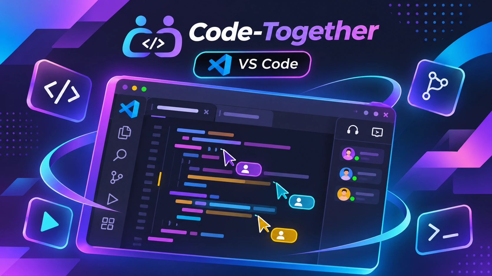

# Code Together for VS Code

The VS Code adapter is an extension scaffold. It currently exposes a **Hello World** command. Shared Perspective integration and the collaboration features shown in the artwork are in development.

## Run from source

1. Open this repository in VS Code and run `npm ci` from its root.
2. Press **F5** to launch an Extension Development Host.
3. In the new window, open the Command Palette and run **Hello World**.

[Code Together overview](https://github.com/KD-Kevin/code-together) · [Shared Perspective](https://github.com/KD-Kevin/Shared-Perspective)
